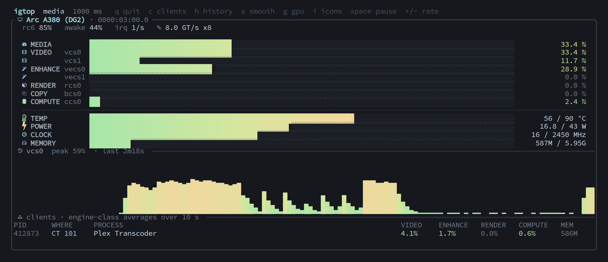
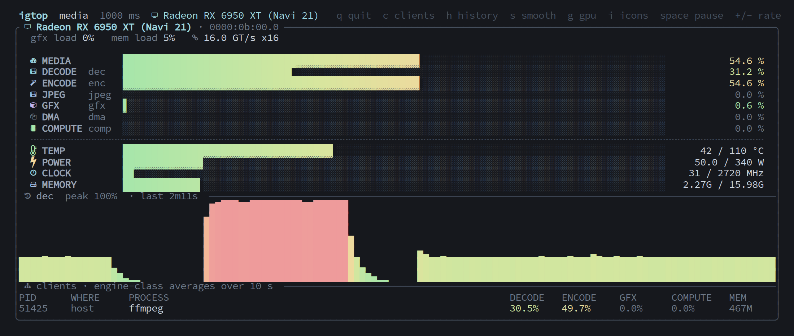
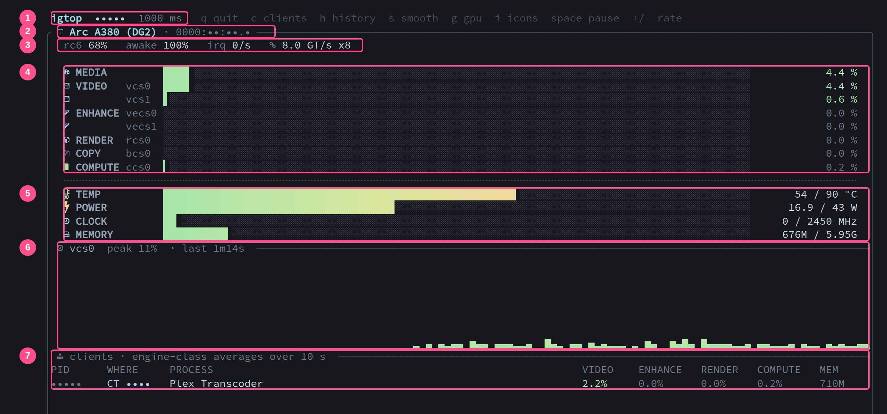
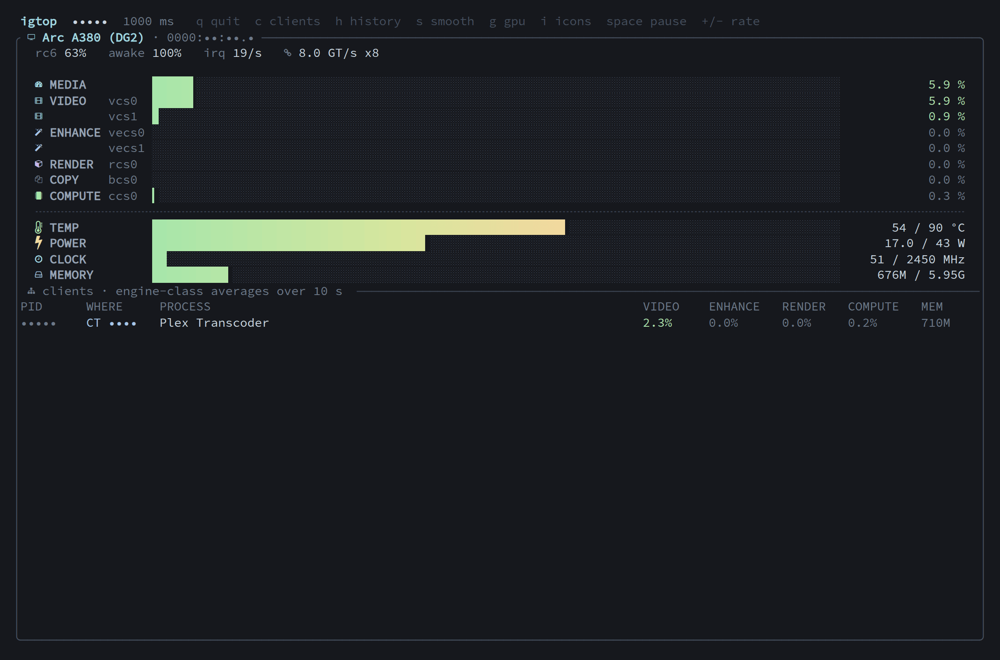
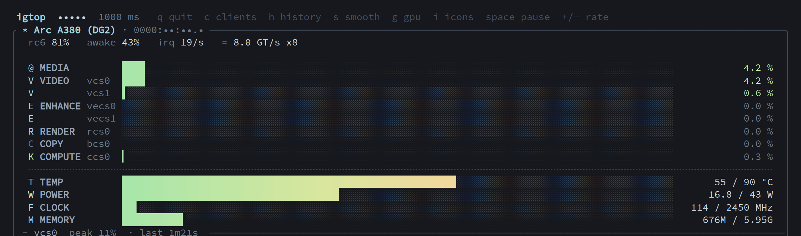
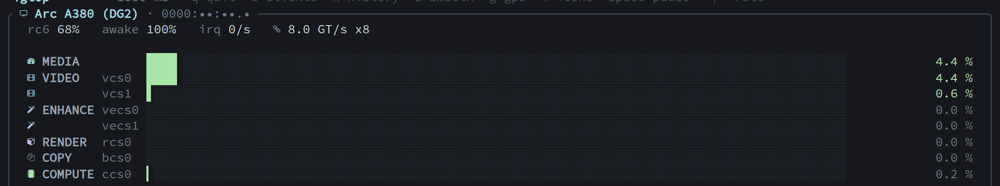
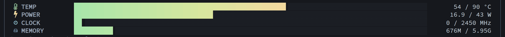
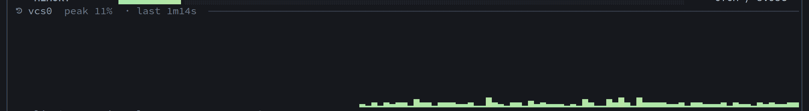
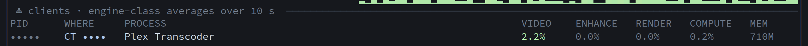
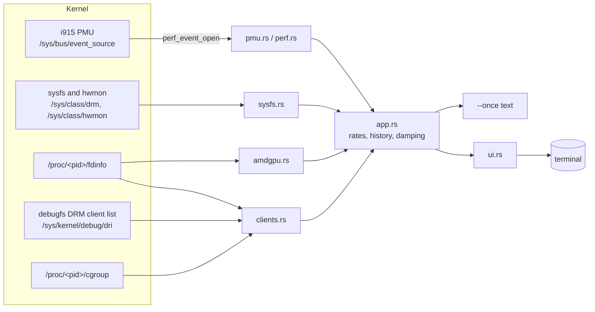

# igtop

[](LICENSE)
[](https://github.com/GladTechInfo/igtop/releases/latest)
[](https://github.com/GladTechInfo/igtop/actions/workflows/ci.yml)
[](#11-development)


**A terminal GPU monitor for Intel graphics on the `i915` driver and AMD graphics on `amdgpu`,
built on the kernel's own counters.** It shows how busy every engine of the card is, the clock the
GPU actually ran at, temperature, power, video memory, and which process — in which container or
virtual machine — is using the card.



igtop is an independent project. It is not affiliated with Intel or AMD and is not part of Intel's
`igt-gpu-tools`.

## Contents

1. [Introduction](#1-introduction)
2. [Features](#2-features)
3. [Screenshots](#3-screenshots)
4. [Quick Start](#4-quick-start)
5. [Installation](#5-installation)
6. [Usage Guide](#6-usage-guide)
7. [Keyboard Shortcuts](#7-keyboard-shortcuts)
8. [Understanding the Interface](#8-understanding-the-interface)
9. [Advanced Usage](#9-advanced-usage)
10. [Technical Details](#10-technical-details)
11. [Development](#11-development)
12. [Licence](#12-licence)

---

## 1. Introduction

### What igtop is

igtop is a small program that runs in a terminal window and draws a live, continuously updated
picture of what your graphics card is doing. It is in the same family as `top` and `htop`, but for
the GPU: instead of CPU and memory, it shows the GPU's individual engines (video decode and encode,
video enhancement, 3D rendering, copy and compute), its clock speed, temperature, power and memory,
and the processes using it.

### The problem it solves

It was written for watching **hardware video transcoding** — Plex, Jellyfin, Emby, ffmpeg with
VA-API or Quick Sync — on Intel Arc cards, where the common tools fall short:

| Reading | What nvtop shows on Intel Arc (at the time of writing) | What igtop shows |
|---|---|---|
| Utilisation | nothing (`gpu_util: null`) | a real per-engine percentage, from the i915 PMU |
| Clock | the *requested* cap, constant even when idle | the clock the GPU actually ran at while awake |
| Video engines | not broken out | `vcs0`, `vcs1`, `vecs0`, `vecs1` separately |
| Process attribution | process ID only | process ID plus its container, e.g. `CT 101` |
| Throttling | not shown | each active throttle reason |
| Scripting | interactive only | `--once` prints plain `key value` text |

Intel's own `intel_gpu_top` reads the same counters and is accurate; igtop adds per-container
attribution, the hardware sensors, a ten-minute history graph and a clock figure that is not
diluted by idle time (see [Intel clock](#intel-clock)).

On AMD cards, `nvtop` and `amdgpu_top` are mature and accurate, and `amdgpu_top` shows far more of
the card than igtop does. igtop's purpose there is narrower: the same view and the same `--once`
output for every card in a machine with both Intel and AMD graphics, container labels on each
process, and the media engines as the headline.

### Who it is for

- **Home-lab and media-server users** who want to see whether hardware transcoding is really
  happening, and how much headroom is left.
- **Proxmox VE, Docker and Podman administrators** who need to know which container or VM is using
  a shared GPU.
- **Developers and advanced users** who want figures that come straight from kernel interfaces,
  with a clear statement of how each one is measured.

---

## 2. Features

| Feature | Description |
|---|---|
| **Per-engine utilisation** | Every engine as a true time ratio: video, video-enhance, render, copy and compute on Intel; decode, encode, JPEG, graphics, DMA and compute on AMD. |
| **MEDIA headline** | The busiest video engine, shown first, because that is what transcoding uses. |
| **Achieved clock** | The clock the GPU ran at, not the requested maximum. |
| **Sensors** | Temperature, power, video memory and PCIe link speed, where the card exposes them. |
| **Throttle reasons** | Intel's active throttle reasons (thermal, power limit and others) on the status line. |
| **Per-process attribution** | Each GPU client with its engine use and memory, labelled with its Proxmox container or VM, Docker, Podman or systemd-nspawn container. |
| **Mixed machines** | Intel and AMD cards side by side in one instance; `g` or `--focus` shows one at a time. |
| **History graph** | Ten minutes of the busiest engine, one column per second. |
| **Damped bars** | Bars rise at once and fall slowly, so a spike is never missed but the display does not flicker. Display only; figures stay raw. |
| **Scripting** | `--once` prints a plain-text snapshot; `--list` lists the cards found. |
| **No runtime dependencies** | One static binary; packages for Debian, Ubuntu, Fedora, RHEL and openSUSE. |

What igtop deliberately does **not** do: it does not change any GPU setting, does not need a
daemon, and keeps no configuration or state files.

---

## 3. Screenshots

All screenshots are genuine captures of igtop running on real hardware. Identifiers that would
reveal the machine they were taken on are redacted: in the newer captures, `•` characters replace
the host name, PCI address, process ID and container number; the two older transcoding captures use
a substitute host name (`media`), an example PCI address and an example container label.

**Intel Arc A380 during a hardware transcode** — the video engines (`vcs0`, `vcs1`) and the
video-enhance engine (`vecs0`) are busy; the client table names the transcoder and its container.


**AMD Radeon RX 6950 XT during a VA-API transcode** — real-time playback, a full-speed burst, then a
4K HEVC pass, visible in the history graph.



**Arc A380 nearly idle, with each area numbered** — explained in
[Understanding the Interface](#8-understanding-the-interface).



---

## 4. Quick Start

On any x86-64 Linux, one command installs the latest release:

```sh
sh -c "$(curl -fsSL https://raw.githubusercontent.com/GladTechInfo/igtop/main/install.sh)"
sudo igtop --list      # which cards igtop found
sudo igtop             # start the monitor; press q to quit
```

The [install script](install.sh) picks the release file for your system — the `.deb` on Debian,
Ubuntu and Proxmox VE, the `.rpm` on Fedora, RHEL and openSUSE, the static binary in
`/usr/local/bin` everywhere else, Arch Linux and Alpine included — checks it against the release's
`SHA256SUMS` and installs it, using `sudo` when you are not root. It prints each command it runs.
igtop needs `sudo` for Intel cards — see [Permissions](#permissions).

Run the same command again to update. To remove igtop:

```sh
curl -fsSL https://raw.githubusercontent.com/GladTechInfo/igtop/main/install.sh | sh -s -- --uninstall
```

The script also takes `--version X.Y.Z` (a particular release), `--method deb|rpm|bin` (another
file than the one it picks) and `--bindir DIR` (where the static binary goes), after `sh -s --` as
above. To do each step by hand, or to build from source, see [Installation](#5-installation).

---

## 5. Installation

### 5.1 Requirements

| Requirement | Details |
|---|---|
| **Operating system** | Linux on x86-64 (64-bit Intel or AMD processors). |
| **Graphics card** | Intel graphics on the `i915` driver, or AMD graphics on the `amdgpu` driver. See [Supported hardware](#supported-hardware). |
| **Kernel** | Linux 5.19 or later for per-process figures (and, on AMD, for the engine bars). Intel parts using GuC submission (Arc, and some recent integrated GPUs) need 6.5 or later for per-process figures. Without them, Intel engine bars and sensors still work. |
| **Privileges** | Root, or the `CAP_PERFMON` capability, for Intel cards. Recommended for AMD cards. See [Permissions](#permissions). |
| **debugfs** | Mounted at `/sys/kernel/debug` for Intel VRAM figures and the fast client scan. Optional. |
| **Font** | A [Nerd Font](https://www.nerdfonts.com/) in your terminal for the icons; otherwise use `--no-icons` or press `i`. |
| **`hwdata`** (optional) | Supplies the PCI ID database used for card names. Recommended by the Debian package. |

Check which driver each card uses before installing:

```sh
lspci -k | grep -A3 -E 'VGA|Display'
```

Look for `Kernel driver in use: i915` or `Kernel driver in use: amdgpu`.

### 5.2 Choosing an installation method

| Method | Best for | Updates |
|---|---|---|
| [Release package](#53-release-packages-deb-and-rpm) (`.deb`, `.rpm`) | Debian, Ubuntu, Proxmox VE, Fedora, RHEL and rebuilds, openSUSE | Install the newer package |
| [Arch Linux / CachyOS package](#54-arch-linux-and-cachyos) | Arch Linux, CachyOS and other Arch-based systems | Rebuild with `makepkg` |
| [Static binary](#55-other-distributions-static-binary) | Any other x86-64 distribution, including Alpine | Replace the file |
| [From source on GitHub](#56-building-from-source-github) | Developers; unreleased changes; other CPU tuning | `git pull` and rebuild |

A **package-manager installation** puts igtop under `/usr/bin` and lets your package manager track,
update and remove it. A **manual installation** (static binary or a source build) puts it wherever
you copy it — usually `/usr/local/bin` — and you update and remove it yourself.

### 5.3 Release packages (.deb and .rpm)

Every [GitHub release](https://github.com/GladTechInfo/igtop/releases/latest) carries four files:

| File | For | Installs to |
|---|---|---|
| `igtop_<version>-1_amd64.deb` | Debian, Ubuntu, Proxmox VE | `/usr/bin/igtop` |
| `igtop-<version>-1.x86_64.rpm` | Fedora, RHEL, Rocky Linux, AlmaLinux, openSUSE | `/usr/bin/igtop` |
| `igtop-<version>-x86_64-linux` | Any x86-64 Linux | wherever you copy it |
| `SHA256SUMS` | Checksums of the three files above | |

All three contain the same statically linked binary, so they behave identically everywhere and
depend on no system libraries. Before a release's files are uploaded, the release workflow installs,
runs and removes each package in containers of Debian 12 and 13, Ubuntu 22.04 and 24.04, Fedora,
Rocky Linux 9, openSUSE Tumbleweed and Alpine.

These are packages attached to GitHub releases, not packages in your distribution's own
repositories: `apt install igtop` or `dnf install igtop` without a file name will not find them.

**Step 1 — download the package and its checksums.** Set `ver` to the latest version, download
`SHA256SUMS`, then download the file for your system:

```sh
ver=$(curl -s https://api.github.com/repos/GladTechInfo/igtop/releases/latest | sed -n 's/.*"tag_name": "v\(.*\)".*/\1/p')
base=https://github.com/GladTechInfo/igtop/releases/download/v$ver
curl -LO "$base/SHA256SUMS"
curl -LO "$base/igtop_${ver}-1_amd64.deb"        # Debian, Ubuntu, Proxmox VE
curl -LO "$base/igtop-${ver}-1.x86_64.rpm"       # Fedora, RHEL, openSUSE
```

To install a particular version instead of the latest, set it by hand, for example `ver=0.2.1`.

**Step 2 — check the download.** This compares the file with the published checksum and must print
`OK` for the file you downloaded:

```sh
sha256sum --check --ignore-missing SHA256SUMS
```

The packages are not signed; this checksum is the check that the file is the one published here.

**Step 3 — install it** with the command for your distribution:

| Distribution | Install command | Notes |
|---|---|---|
| Debian 12, 13 | `sudo apt install ./igtop_*_amd64.deb` | The `./` tells `apt` to install a local file. |
| Ubuntu 22.04, 24.04 and later | `sudo apt install ./igtop_*_amd64.deb` | As Debian. |
| Proxmox VE | `sudo apt install ./igtop_*_amd64.deb` | Run on the host, where the GPU is. As root, omit `sudo`. |
| Fedora | `sudo dnf install ./igtop-*.x86_64.rpm` | |
| RHEL, Rocky Linux, AlmaLinux | `sudo dnf install ./igtop-*.x86_64.rpm` | |
| openSUSE Tumbleweed, Leap | `sudo zypper install --allow-unsigned-rpm ./igtop-*.x86_64.rpm` | `zypper` refuses unsigned local packages without the flag. |

**Step 4 — confirm it works:**

```sh
igtop --version
sudo igtop --list
```

### 5.4 Arch Linux and CachyOS

igtop is **not yet in the AUR**: the package is ready, but AUR account registration was paused when
it was prepared. Until it is published, build the same package from this repository with
`makepkg`, which downloads the release's source, compiles it, runs the tests and installs the result
under `/usr/bin` through `pacman`:

```sh
sudo pacman -S --needed git base-devel rust      # build tools, if not already installed
git clone https://github.com/GladTechInfo/igtop
cd igtop/packaging/aur
makepkg -si                                       # build, then install with pacman
```

CachyOS and other Arch-based distributions use exactly the same steps. If you use `rustup` rather
than the `rust` package, `makepkg` uses your rustup toolchain; leave `rust` out of the first command.

To remove it later: `sudo pacman -R igtop`. Alternatively, use the static binary (next section).

### 5.5 Other distributions (static binary)

The static binary runs on any x86-64 Linux distribution, whatever its C library (glibc or musl), so
it suits Alpine, Void, Gentoo, NixOS (outside the Nix store), Slackware and others:

```sh
ver=$(curl -s https://api.github.com/repos/GladTechInfo/igtop/releases/latest | sed -n 's/.*"tag_name": "v\(.*\)".*/\1/p')
base=https://github.com/GladTechInfo/igtop/releases/download/v$ver
curl -LO "$base/SHA256SUMS"
curl -LO "$base/igtop-${ver}-x86_64-linux"
sha256sum --check --ignore-missing SHA256SUMS                     # must print OK
sudo install -m 0755 "igtop-${ver}-x86_64-linux" /usr/local/bin/igtop
```

`install -m 0755` copies the file and makes it executable for every user. `/usr/local/bin` is the
conventional place for software not managed by the package manager.

### 5.6 Building from source (GitHub)

Building from source compiles igtop on your own machine. It takes a few minutes the first time.

**Step 1 — install Git, a C linker and `curl`.** Rust uses the system's C linker to produce the
final program.

| Distribution | Command |
|---|---|
| Debian, Ubuntu, Proxmox VE | `sudo apt install git curl build-essential` |
| Fedora, RHEL, Rocky, Alma | `sudo dnf install git curl gcc binutils` |
| openSUSE | `sudo zypper install git curl gcc binutils` |
| Arch Linux, CachyOS | `sudo pacman -S --needed git curl base-devel` |
| Alpine | `sudo apk add git curl build-base` |

**Step 2 — install Rust 1.88 or later.** Distribution Rust packages are often older than this
(Debian 12 ships 1.63), so the recommended route is [rustup](https://rustup.rs/), the official
installer, which installs Rust in your home directory without touching the system:

```sh
curl --proto '=https' --tlsv1.2 -sSf https://sh.rustup.rs | sh
. "$HOME/.cargo/env"          # make cargo available in this terminal
rustc --version               # should print 1.88.0 or later
```

On Arch Linux and CachyOS, `sudo pacman -S rustup && rustup default stable` does the same.

**Step 3 — download the source code:**

```sh
git clone https://github.com/GladTechInfo/igtop
cd igtop
```

`git clone` copies the repository into a new `igtop` directory; `cd` enters it.

**Step 4 — build a release binary:**

```sh
cargo build --release
```

Cargo downloads the Rust libraries igtop uses, compiles everything with optimisations and writes
the program to `target/release/igtop`.

**Step 5 — run it from the build directory:**

```sh
sudo ./target/release/igtop
```

**Step 6 — install it system-wide (optional):**

```sh
sudo install -m 0755 target/release/igtop /usr/local/bin/igtop
```

After this, `sudo igtop` works from any directory.

**Step 7 — update to the latest source later:**

```sh
cd igtop
git pull                       # fetch the latest changes
cargo build --release          # rebuild
sudo install -m 0755 target/release/igtop /usr/local/bin/igtop
```

To build a particular release rather than the latest development state, check out its tag first,
for example `git checkout v0.2.1`.

For a static binary that runs on other machines, see [Static builds](#static-builds).

### 5.7 Updating

| Installed with | How to update |
|---|---|
| Install script | Run the install command again. |
| `.deb` package | Download the newer `.deb` and install it the same way; `apt` replaces the old version. |
| `.rpm` package | Download the newer `.rpm` and install it the same way; `dnf` or `zypper` replaces the old version. |
| `makepkg` (Arch, CachyOS) | `cd igtop && git pull && cd packaging/aur && makepkg -si` |
| Static binary | Download the newer binary and repeat the `install` command. |
| Source build | See step 7 above. |

`igtop --version` shows which version is installed.

### 5.8 Uninstalling

| Installed with | How to remove |
|---|---|
| Install script | `curl -fsSL https://raw.githubusercontent.com/GladTechInfo/igtop/main/install.sh \| sh -s -- --uninstall` |
| `.deb` package | `sudo apt remove igtop` |
| `.rpm` package (Fedora, RHEL) | `sudo dnf remove igtop` |
| `.rpm` package (openSUSE) | `sudo zypper remove igtop` |
| `makepkg` (Arch, CachyOS) | `sudo pacman -R igtop` |
| Static binary or source build | `sudo rm /usr/local/bin/igtop`, and delete the cloned `igtop` directory if you have one. |

igtop writes no configuration or state files, so nothing else is left behind.

---

## 6. Usage Guide

### Starting igtop

```sh
sudo igtop
```

igtop finds every supported card and draws one panel for each. Press `q` to quit. On a machine with
only AMD graphics, `igtop` without `sudo` also works, but sees only your own processes.

### Permissions

| Card | Without root | With root (`sudo`) |
|---|---|---|
| **Intel (`i915`)** | Not shown: the i915 performance counters are a system-wide event source, which an ordinary user cannot open at the usual `kernel.perf_event_paranoid` setting. igtop says which cards it could not open. | Everything. |
| **AMD (`amdgpu`)** | Shown, but the engine bars and client table count only your own processes; the panel title says `not root — own processes only`. | Every process. |

Lowering `kernel.perf_event_paranoid` would also let an ordinary user read the Intel counters, but
it affects every program on the machine; running one monitoring tool as root is the smaller change.

### Everyday examples

| Command | What it does |
|---|---|
| `sudo igtop` | The monitor, sampling once a second. |
| `sudo igtop --list` | Lists the cards found, in the order the monitor shows them, and exits. |
| `sudo igtop -d 03:00.0` | Shows only the card at PCI address `03:00.0` (the short form or the full `0000:03:00.0`). |
| `sudo igtop -g 1` | Starts showing only the second card in `--list` order; press `g` to cycle. |
| `sudo igtop -i 250` | Samples four times a second. |
| `sudo igtop --no-clients` | Skips the per-process scan, which is cheaper on a very busy host. |
| `sudo igtop --once` | Prints one plain-text snapshot and exits. |
| `sudo igtop --once --no-clients` | The same, without per-process lines. |

`--list` prints one line per card: the PMU name (Intel) or `amdgpu`, the PMU type number (`-` for
AMD), the PCI address and the engines igtop will show. For example:

```text
i915_0000_03_00.0        type=52   pci=0000:03:00.0  engines: vcs0 vcs1 vecs0 vecs1 rcs0 bcs0 ccs0
```

### Watching a transcode

1. Start igtop: `sudo igtop`.
2. Start playback in your media server with a format the client cannot play directly, so that the
   server transcodes.
3. Watch **MEDIA** and the **VIDEO** rows: hardware decoding and encoding use the video engines
   (`vcs*` on Intel, `DECODE`/`ENCODE` on AMD). Scaling and tone-mapping often use **ENHANCE**
   (`vecs*`) on Intel, or **RENDER**/**COMPUTE** if done with shaders.
4. The **client table** names the process doing the work and the container it runs in.

If MEDIA stays at zero while the CPU is busy, the transcode is running in software.

### Troubleshooting

| Symptom | Cause and remedy |
|---|---|
| `no supported GPUs found` | No card is on `i915` or `amdgpu`. Run `lspci -k \| grep -A3 -E 'VGA\|Display'`: `xe` is not supported yet; `vfio-pci` means the card is passed through to a VM (run igtop inside that VM); no driver means the module is not loaded. |
| An Intel card is listed as *not shown*, or the PMU cannot be opened | Run igtop as root (or with `CAP_PERFMON`). |
| An AMD panel says `not root — own processes only` | Without root, igtop can read only your own processes' figures. Run it with `sudo`. |
| No VRAM figure on Intel, or a slow client scan | debugfs is not mounted: `sudo mount -t debugfs none /sys/kernel/debug`. |
| The panel title says `PMU read failed — figures frozen` | A read of the Intel counters failed; the figures shown are no longer live. Restart igtop; if it recurs, check `dmesg` for i915 errors. |
| Squares or question marks instead of icons | The terminal font lacks Nerd Font glyphs. Install a [Nerd Font](https://www.nerdfonts.com/) or use `--no-icons`. |
| The client table is empty while the engines are busy | Per-process figures need Linux 5.19 or later (6.5 or later for Intel GuC parts). On Intel, a client's figure can also trail the bars by a few seconds; see [Clients](#clients). |
| `Illegal instruction` from a binary you built | Your Rust standard library contains AVX-512 instructions; see [Static builds](#static-builds). |

---

## 7. Keyboard Shortcuts

Keys take effect immediately; none of them is saved, so igtop always starts with the defaults or
the options given on the command line.

### General

| Key | Action | Explanation |
|---|---|---|
| `q`, `Esc`, `Ctrl+C` | Quit | Restores the terminal and exits. |
| `Space` | Pause or resume | Stops sampling and freezes the display; the header shows **paused**. Press again to resume. Every rate starts afresh on resume, so the first reading never averages the paused time. |
| `+` (or `=`) | Sample faster | Steps the sampling interval down: 10000 → 5000 → 2000 → 1000 → 500 → 250 → 100 → 50 ms. The header shows the interval. |
| `-` (or `_`) | Sample slower | Steps the sampling interval up the same ladder. |


*Paused (1): the header says `paused`. Press `Space` again to resume.*


*After `+` (1): the interval has stepped from 1000 to 500 ms. Press `-` to return.*

### Display

| Key | Action | Explanation |
|---|---|---|
| `c` | Client table on or off | Hides or shows the per-process table. While hidden, the process scan stops, which saves a little CPU. Showing it again restarts its averages. |
| `h` | History graph on or off | Hides or shows the ten-minute graph; the client table moves up to use the space. Press `h` again to bring it back. |
| `g` | Cycle cards | On a machine with two or more cards: all cards → first → second → … → all. With one card it does nothing. The order is that of `--list`. |
| `s` | Damping on or off | Switches between damped bars (rise fast, fall slowly) and raw bars that jump to each new sample. Figures are always raw. |
| `i` | Icons or ASCII | Switches between Nerd Font icons and plain ASCII letters, for terminals without a Nerd Font. |



*After `h`: the history graph is hidden and the client table follows the sensors.*



*After `i`: icons are replaced by ASCII letters (`V` video, `E` enhance, `T` temperature and so
on).*

---

## 8. Understanding the Interface


| No. | Area | What it shows |
|---|---|---|
| 1 | **Header** | The program name, the host name and the sampling interval, followed by a reminder of the keys. **paused** appears here while paused. |
| 2 | **Card title** | The card's name and PCI address. On a machine with several cards, each has its own panel. |
| 3 | **Status line** | Driver-specific state: power saving, interrupts, PCIe link, fan and throttle reasons. |
| 4 | **Engines** | One bar per engine, with the MEDIA headline on top. |
| 5 | **Sensors** | Temperature, power, clock and video memory, each against its ceiling. |
| 6 | **History** | Ten minutes of the busiest engine. |
| 7 | **Clients** | The processes using the card, with their container, engine use and memory. |

### Colours

Every bar is coloured cell by cell along a ramp from green through amber to red, so a bar's colour
at its tip says how full it is before you read the number. The dotted part of each row is the empty
track, so the full width is always 100 % of that row's ceiling. Figures beside the bars follow the
same colours.

### The status line



| Item | Driver | Meaning |
|---|---|---|
| `rc6` | Intel | The share of time the GPU spent in RC6, its deepest power-saving state. High at idle, low when busy. |
| `awake` | Intel | The share of time the GPU was awake (not parked), measured by the PMU. |
| `irq` | Intel | GPU interrupts per second. |
| `gfx load` | AMD | The firmware's own busy figure for the graphics block (`gpu_busy_percent`). |
| `mem load` | AMD | The firmware's own busy figure for the memory controller (`mem_busy_percent`). |
| Link (e.g. `8.0 GT/s x8`) | both | The PCIe link the card trained to. Shown in red, as `<current> of <maximum>`, only if it is below what the slot and card can both reach. |
| Fan (`rpm`) | both | Fan speed, if the card reports a working tachometer. |
| Throttle reasons | Intel | Any active `throttle_reason_*` flag (for example `THERMAL`), in red. Absent when nothing throttles. |

### Engines

Each row is one hardware engine. The bar and the percentage are the share of the last sampling
interval during which that engine was busy.

| Row | Intel engine | AMD engine | Used for |
|---|---|---|---|
| **MEDIA** | busiest of `vcs*` and `vecs*` | busiest of decode, encode, JPEG | Headline for video work. |
| **VIDEO** / **DECODE**, **ENCODE** | `vcs0`, `vcs1` (video codec) | `dec`, `enc` (the second encode ring, `enc_1`, is counted in `enc`) | Hardware decoding and encoding. Intel's video engines both decode and encode. |
| **ENHANCE** | `vecs0`, `vecs1` (video enhancement) | — | Scaling, colour conversion, de-interlacing. |
| **JPEG** | — | `jpeg` | Hardware JPEG decoding. |
| **RENDER** / **GFX** | `rcs0` | `gfx` | 3D, and shader-based filters such as tone-mapping. |
| **COPY** / **DMA** | `bcs0` | `dma` | Memory copies. |
| **COMPUTE** | `ccs*` | `comp` | OpenCL, Level Zero, ROCm and other compute work. |

On Intel the engines are discovered from the PMU, so they depend on the card: an integrated GPU
usually has one video engine, an Arc card two. On AMD the set is fixed at the six classes above,
because amdgpu reports an engine class only once it has been used. `--list` shows the engines igtop
will draw for each card.

### Sensors



| Row | Shows | Ceiling (right-hand figure) | Kind of value |
|---|---|---|---|
| **TEMP** | Intel: the card's temperature. AMD: the junction (hotspot) sensor on discrete cards, edge on integrated. | Intel: 90 °C, a **display scale only** — Intel publishes no limit for Arc cards; the authoritative overheating signal is the `THERMAL` throttle reason. AMD: the card's own critical limit. | Measured |
| **POWER** | The card's power draw in watts. Discrete cards only. | The card's power limit. | Measured (Intel: from the energy counter over the interval) |
| **CLOCK** | Intel: the mean clock **while the GPU was awake**. AMD: the shader clock at the moment of sampling. | The highest clock the card can run at. | Intel: calculated. AMD: measured. |
| **MEMORY** | Video memory in use. Discrete cards; on AMD APUs, the carve-out reserved for the GPU. | Total video memory. | Measured |

A missing row means the card does not expose that reading — it is left out, never shown as zero.
Integrated Intel GPUs, for example, have no temperature, power, VRAM or PCIe link of their own.

### History



The graph follows the engine with the highest peak on screen, named at its left (`vcs0` above),
with that peak and how long the visible stretch covers (`last 1m14s`). Each column is the **mean
over one second**, whatever the sampling interval, and the newest second is at the right edge. Ten
minutes are kept; a wider terminal shows more of them.

### Clients



| Column | Meaning |
|---|---|
| **PID** | Process ID. |
| **WHERE** | Where the process runs: `CT n` or `VM n` on Proxmox VE; `docker <id>` or `podman <id>` with the 12-character container ID that `docker ps` shows; a systemd-nspawn machine name; or `host`. |
| **PROCESS** | Process name. |
| **VIDEO**, **ENHANCE**, **RENDER**, **COMPUTE** (Intel) / **DECODE**, **ENCODE**, **GFX**, **COMPUTE** (AMD) | The process's share of each engine **class**, averaged over the last 10 seconds. |
| **MEM** | GPU memory the process holds — an estimate; see below. |

Two points help when reading the table:

- **It is attribution, not the live measure.** The engine bars are live; the table is averaged over
  10 seconds, because on Intel the driver credits a context's time in bursts.
- **Figures are per engine class.** On a card with two video engines, a client saturating one of
  them reads 50 % in VIDEO while that engine's own bar reads 100 %.

**MEM is an estimate.** Both drivers count a shared buffer in the figure of every client that holds
it. igtop adds each client's private memory and counts shared memory once per process, as its
largest client's figure. Which buffers overlap between processes is not published.

### Units

| Unit | Meaning |
|---|---|
| `%` | Share of time busy (engines, rc6, awake, load) or share of a ceiling (sensor bars). |
| `°C` | Degrees Celsius. |
| `W` | Watts. |
| `MHz` | Megahertz. |
| `M`, `G` | Mebibytes and gibibytes (binary: 1 G = 1024³ bytes). |
| `GT/s` | PCIe gigatransfers per second per lane; `x8` is the number of lanes. |
| `/s` | Per second. |

### Measured, calculated and estimated values

| Kind | Values |
|---|---|
| **Measured** — read directly from a kernel counter or sensor | Intel engine busy time, rc6 and awake time, interrupts; temperatures; AMD clock; VRAM; PCIe link; fan; throttle reasons; firmware load. |
| **Calculated** — derived from measured counters | Every percentage (busy time ÷ elapsed time); Intel power (energy ÷ time); Intel clock (frequency integral ÷ awake time); AMD engine bars (sum of every client's busy time). |
| **Estimated** | Per-process memory (MEM). |
| **Display only** | Damped bar lengths; Intel's 90 °C temperature scale. |

---

## 9. Advanced Usage

### Command-line options

| Option | Meaning | Default |
|---|---|---|
| `-i`, `--interval <MS>` | Sampling interval in milliseconds, 50–10000 (values outside are clamped). | 1000 |
| `-d`, `--device <PCI>` | Show one card only: `0000:BB:DD.F` or the short `BB:DD.F`, case-insensitive. | all cards |
| `-g`, `--focus <N>` | Start showing only card *N* (counting from 0, in `--list` order). | all cards |
| `--once` | Print one plain-text snapshot and exit. | |
| `--list` | List the cards found and exit. | |
| `--no-clients` | Skip the per-process scan. | scan on |
| `--no-smooth` | Raw, undamped bars. | damped |
| `--damping <SEC>` | Seconds for a bar to fall by about 90 %, 0.2–30 (values outside are clamped). | 4 |
| `--fps <N>` | Animation frame rate while bars move, 5–240. | 30 |
| `--no-icons` | ASCII markers instead of Nerd Font glyphs. | icons |
| `-V`, `--version` | Print the version and exit. | |
| `-h`, `--help` | Print the help text, with notes on each figure, and exit. | |

igtop has **no configuration file**. To make options permanent, use a shell alias, for example
`alias igtop='sudo igtop --no-icons'` in `~/.bashrc`.

### Sampling, drawing and cost

Sampling and drawing are separate. Every sample redraws the screen, so temperature, clock and power
update at the sampling rate. Between samples, igtop redraws at up to `--fps` frames per second only
while a damped bar is still moving, and skips a frame when nothing would move by a visible step
(an eighth of a cell, or 0.1 in a figure). Once everything has settled it sleeps until the next
sample or key press.

Drawing is nearly all of igtop's CPU cost: about 2.5 % of one core at the default 30 frames per
second during a transcode, and less at idle. To reduce it, lower `--fps`, or use `--no-smooth`,
which draws only once per sample.

### Scripting with `--once`

`--once` takes two samples one interval apart (`-i`, at least 200 ms; one second by default),
prints one snapshot and exits. Each card begins with a heading line; its figures follow as indented
`key value` lines, and each client is one line of `key=value` pairs. An abridged example from an
Arc A380 at idle (the PCI address, PID and container are examples; the figures are real):

```text
Arc A380 (DG2) [0000:03:00.0]
  engine vcs0     0.94%
  engine vecs0    1.05%
  engine rcs0     0.00%
  driver            i915
  pmu_status        ok
  freq_act_mhz      19
  freq_act_avg_mhz  18
  freq_cap_mhz      2450
  rc6_pct           68.13
  power_w           16.87
  power_max_w       43
  temp_c            55.0
  vram_used_b       585089024
  vram_total_b      6383730688
  link_cur          8.0 GT/s x8
  throttle          none
  client pid=4242 where="CT 101" comm="Plex Transcoder" video=0.5% enhance=0.0% render=0.0% copy=0.0% compute=0.0% mem_b=572084224
```

Format rules:

- The `driver` line says which driver the card is on; the keys that follow are that driver's
  (`rc6_pct`, `freq_req_mhz` and `rc6_pmu_pct` on Intel; `gpu_busy_pct` and `engine_scope` on AMD,
  for example). A reading the card does not expose is printed as `n/a`.
- Sizes are in bytes (`_b`), clocks in MHz, power in watts, temperatures in °C.
- Client engine keys are named as the driver names them: `video`, `enhance`, `render`, `copy`,
  `compute` on Intel; `dec`, `enc`, `jpeg`, `gfx`, `dma`, `compute` on AMD.
- A value containing spaces, quotes or control characters is double-quoted, with `\\`, `\"` and
  `\xNN` escapes. Process names come from inside containers, so they are never printed raw.
- Piping into `head` or similar exits quietly.

Examples:

```sh
# Report any Intel video engine above 90 %
sudo igtop --once --no-clients | awk '$1=="engine" && $2 ~ /^vcs/ && $3+0 > 90 {print "busy:", $2, $3}'

# The temperature of every card, one per line
sudo igtop --once --no-clients | awk '$1=="temp_c" {print $2}'

# Log a snapshot every minute from root's crontab
* * * * * /usr/bin/igtop --once --no-clients >> /var/log/igtop.log 2>&1
```

### Machines with several cards

igtop shows every supported card at once, Intel and AMD alike, each in its own panel. Use
`-d <PCI address>` to restrict it to one card permanently, or `-g <N>` and the `g` key to switch
between them. On a mixed machine run without root, the Intel cards are reported as *not shown*
rather than silently dropped, and the AMD cards are still displayed.

<a id="supported-hardware"></a>
### Supported hardware

What igtop shows depends on what the driver exposes. Missing readings are left out, not shown as
zero.

**Intel, on `i915`** — Arc Alchemist (A310, A380, A580, A750, A770 and the mobile parts) and
integrated graphics from Gen9 onwards.

| | Discrete (Arc) | Integrated |
|---|---|---|
| Engine utilisation, clock, rc6, throttle reasons, clients | yes | yes |
| Temperature, power | yes | no — i915 publishes no hwmon sensors for integrated GPUs |
| VRAM | yes | no — shared system memory |
| PCIe link | yes | no — not on a PCIe link |

**Not supported: the `xe` driver.** Arc Battlemage (B570, B580), Lunar Lake, Panther Lake and later
use `xe` only, and Alchemist cards can optionally be bound to `xe`. `xe` publishes a different PMU
and fdinfo format, so igtop finds nothing there and says so.

**AMD, on `amdgpu`** — discrete Radeon cards and integrated graphics (APUs).

| | Discrete | Integrated (APU) |
|---|---|---|
| Engine utilisation, clock, firmware load, clients | yes | yes |
| Temperature | junction, against the card's critical limit | edge |
| VRAM | yes | yes — the carve-out reserved for the GPU |
| Power, PCIe link | yes | no — an APU's figures are the whole package's |
| Throttle reasons | not yet | not yet |

**Tested on:** Intel Arc A380 and UHD Graphics 630; AMD Radeon RX 6950 XT and the integrated
Radeon 610M. Reports from other cards are welcome.

---

## 10. Technical Details

This section is for readers who want to know exactly where each figure comes from.

### Architecture

igtop is a single Rust binary of about 4,600 lines, in nine modules:

| Module | Responsibility |
|---|---|
| `main.rs` | Command-line parsing, card discovery, the `--list` and `--once` modes, and the event loop that separates sampling from drawing. |
| `pmu.rs` | Discovers each i915 PMU under `/sys/bus/event_source/devices/` and its engine events; samples them. |
| `perf.rs` | A minimal `perf_event_open` binding (the system call that opens PMU counters). |
| `sysfs.rs` | Everything the PMU does not expose: hwmon temperature, fan, power and energy; frequency ceiling; throttle reasons; PCIe link; VRAM size. |
| `amdgpu.rs` | AMD engine utilisation, from every client's fdinfo. |
| `clients.rs` | Per-process DRM accounting from `/proc/<pid>/fdinfo`, and container attribution from cgroups. |
| `app.rs` | Per-card state, driver-neutral above its data source: rates, history and the damped values the bars are drawn from. |
| `ui.rs` | Rendering with ratatui; bars are drawn cell by cell rather than with a stock gauge widget. |
| `theme.rs` | Colour ramp and glyphs. |



### Intel engines

Each i915 device publishes its own event source under `/sys/bus/event_source/devices/`: a discrete
card's is named `i915_<PCI address>`, an integrated GPU's is the bare `i915`. Each engine has a
busy-time counter in nanoseconds, so utilisation is a true time ratio rather than a sampled guess.
Rates divide by the kernel's own `time_enabled`, read atomically with the counters. The PMU is
system-wide, so work inside a container is counted from the host without entering it.

### AMD engines

amdgpu has no system-wide busy counter. It publishes each client's cumulative time per engine class
in `/proc/<pid>/fdinfo` (lines such as `drm-engine-gfx: 41857634272 ns`), so igtop adds up the
advance of every client on the card over each interval. That is still a time ratio, and work inside
a container is still counted from the host, but it differs from Intel's PMU in three ways:

- A job counts from when it reaches the hardware ring until it completes, so work queued behind
  another context's counts as busy. Several contexts on one engine class can add up to more than the
  wall time; the bar stops at 100 %.
- Work by a client that exits mid-interval is lost, and a client is measured from its first
  sighting, so very short-lived clients are undercounted.
- Only processes igtop may inspect are counted — all of them as root.

The firmware's own `gpu_busy_percent` and `mem_busy_percent` appear on the status line as a
cross-check. They cover the graphics block and the memory controller only: during a hardware decode
measured at 86 %, the firmware's figure read under 10 %, which is why it is not used for the bars.

<a id="intel-clock"></a>
### Intel clock

The kernel integrates **0 MHz while the GPU is parked**, so the plain mean frequency over an interval
is the running clock multiplied by the fraction of time awake: a GPU at 2000 MHz for 30 % of a
second averages about 600 MHz. That diluted figure is what `intel_gpu_top` shows. igtop divides the
same integral by the PMU's awake time instead, giving the clock the GPU actually ran at. `--once`
prints both: `freq_act_mhz` (while awake) and `freq_act_avg_mhz` (diluted).

nvtop reads `gt_cur_freq_mhz`, which is the **requested** frequency, so an idle card reads its
maximum while the hardware is asleep.

### AMD clock

The hwmon frequency input labelled `sclk`: the shader clock at the moment of sampling, which amdgpu
reports as achieved rather than requested. An idle card reads tens of MHz. The ceiling is the top
level of `pp_dpm_sclk`.

### rc6 (Intel)

rc6 residency is read from sysfs (`rc6_residency_ms`), the hardware counter, not from the PMU. With
GuC SLPC, the PMU's `rc6-residency` event can stand still on an idle card while the hardware counter
advances: `get_rc6()` in the kernel's `i915_pmu.c` never reports less than it last did, so an
estimate that once ran ahead of the hardware holds the event flat until the hardware catches up.
`--once` prints both as `rc6_pct` and `rc6_pmu_pct`.

### PCIe link

The link is judged against what the slot can actually train to — the lower of the card's own
maximum and the upstream port's — so a Gen4 card in a Gen3 slot running at Gen3 is shown as normal.
Arc and recent Radeon boards carry an internal PCIe switch, so igtop reports the link of the card's
upstream port rather than the GPU function's internal one.

<a id="clients"></a>
### Clients

Per-process figures come from `/proc/<pid>/fdinfo` on both drivers:

- **Deduplication.** A client holding several file descriptors on the same device reports identical
  cumulative counters on each; summing them would multiply the answer. igtop deduplicates on
  `(drm-pdev, drm-client-id)`.
- **Folding.** Several clients in one process (for example a transcoder using VA-API to decode and
  OpenCL to tone-map) are folded into one row.
- **Finding clients.** The processes to examine come from the DRM core's own client list in debugfs.
  Without debugfs, igtop walks every process's file descriptors, which costs far more on a busy host.
  On AMD the same scan feeds the engine bars, so processes are walked once per sample.
- **Container attribution.** Each process's cgroup path identifies Proxmox LXC containers and QEMU
  VMs, Docker, Podman and systemd-nspawn containers.

On Intel with GuC submission, i915 updates a context's runtime when the context is switched out, so
over a short window a busy client reads in bursts. The table therefore averages each client over 10
seconds on both drivers.

### Damping

Bars rise quickly and fall slowly, like a shock absorber; the time constants are in seconds, so the
feel does not depend on the sampling or frame rate. `--damping` sets the fall time. Damping affects
only bar lengths: the figures beside the bars, the history graph and `--once` are always raw.

### Permissions and safety

- Opening the i915 PMU needs `CAP_PERFMON` (or root) at the usual `perf_event_paranoid` level.
- igtop only reads. It writes nothing to sysfs, debugfs or the GPU.
- Process names come from inside containers, so `--once` never prints them raw (see the quoting
  rules above): a name cannot carry terminal escape sequences into the terminal of a script's
  reader.

### Dependencies

| Crate | Version | Purpose |
|---|---|---|
| [ratatui](https://ratatui.rs/) | 0.29.0 | Terminal user interface. |
| [crossterm](https://github.com/crossterm-rs/crossterm) | 0.28.1 | Terminal input and output. |
| [libc](https://github.com/rust-lang/libc) | 0.2 | System calls: `perf_event_open`, `geteuid`, signal disposition. |

### Limitations

- `i915` and `amdgpu` only; `xe` is not supported.
- AMD throttle reasons are not shown yet: amdgpu publishes them only inside the binary
  `gpu_metrics` table, whose layout varies by chip.
- On Intel parts with a separate media GT (Meteor Lake), CLOCK and rc6 describe the primary GT
  only. The media engines' utilisation is still shown.
- Container labels cover Proxmox, Docker, Podman and systemd-nspawn; other runtimes show as `host`.
- x86-64 only.

---

## 11. Development

### Building

| Task | Command |
|---|---|
| Debug build | `cargo build` |
| Optimised build for this machine | `cargo build --release` → `target/release/igtop` |
| Static, portable binary | `./build.sh` → `target/x86_64-unknown-linux-musl/release/igtop` |
| Tests | `cargo test` |
| Drawing benchmark | `cargo test --release -- --ignored --nocapture bench` |
| Lints, as CI runs them | `cargo clippy --all-targets -- -D warnings` |

The minimum Rust version is **1.88**, set by the locked dependencies in `Cargo.lock`; the project
builds with 1.88.0 and with current stable.

<a id="static-builds"></a>
### Static builds

`build.sh` produces a musl-linked static binary for baseline x86-64, so it runs on any x86-64 Linux
and any x86-64 CPU. It needs the musl target, and `objdump` (from binutils) for its final check:

```sh
rustup target add x86_64-unknown-linux-musl
./build.sh
```

The script refuses the result if it contains AVX-512 instructions. Some distributions (CachyOS, for
one) ship a Rust standard library built for x86-64-v4, which puts AVX-512 instructions in every
binary regardless of `-C target-cpu`; such a binary dies with `Illegal instruction` on older CPUs.
If `build.sh` reports this, rebuild the standard library from source:

```sh
rustup component add rust-src
IGTOP_BUILD_STD=1 ./build.sh
```

### Packaging

| Path | Purpose |
|---|---|
| `Cargo.toml` → `[package.metadata.deb]` | Debian package, built with `cargo deb`. |
| `Cargo.toml` → `[package.metadata.generate-rpm]` | RPM package, built with `cargo generate-rpm`. |
| `packaging/aur/PKGBUILD`, `.SRCINFO` | Arch Linux package. |
| `.github/workflows/ci.yml` | On every push: clippy, tests and `build.sh`. |
| `.github/workflows/release.yml` | On a published release: builds the static binary, `.deb`, `.rpm` and `SHA256SUMS`, tests them in eight distribution containers, then uploads them. |
| `.github/workflows/aur.yml` | On a published release: updates and pushes the AUR package (awaiting an AUR account). |

### Contributing and reporting problems

Bug reports, readings from cards not listed above, and pull requests are welcome through
[GitHub issues](https://github.com/GladTechInfo/igtop/issues). Please include:

- `igtop --version` and `igtop --list`;
- the kernel version (`uname -r`) and distribution;
- where a figure looks wrong, the output of `sudo igtop --once`.

Before sending a pull request, run `cargo clippy --all-targets -- -D warnings` and `cargo test`.

---

## 12. Licence

igtop is free software, licensed under the **GNU General Public License v3.0 or later**
(`GPL-3.0-or-later`). See [LICENSE](LICENSE) for the full text.

It is built with [ratatui](https://ratatui.rs/) and
[crossterm](https://github.com/crossterm-rs/crossterm) (both MIT-licensed) and
[libc](https://github.com/rust-lang/libc) (MIT or Apache-2.0). Intel, Arc, AMD and Radeon are
trademarks of their respective owners; their use here is descriptive only.
